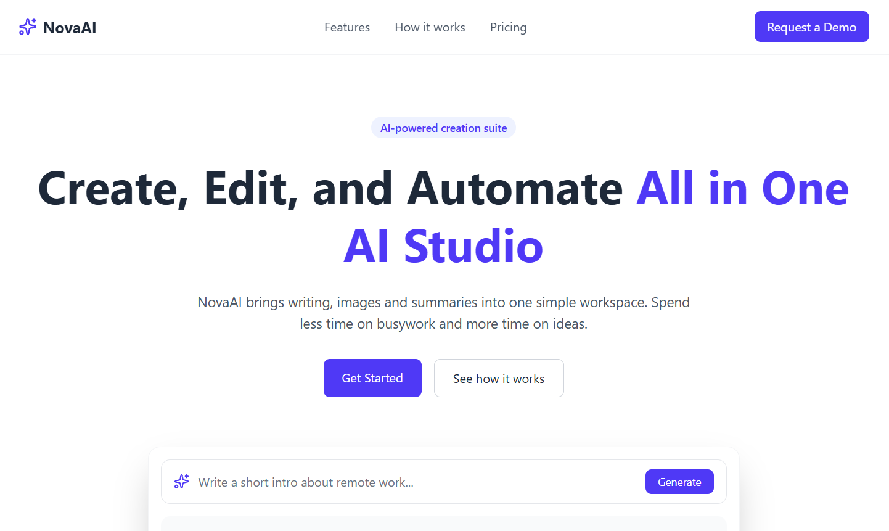
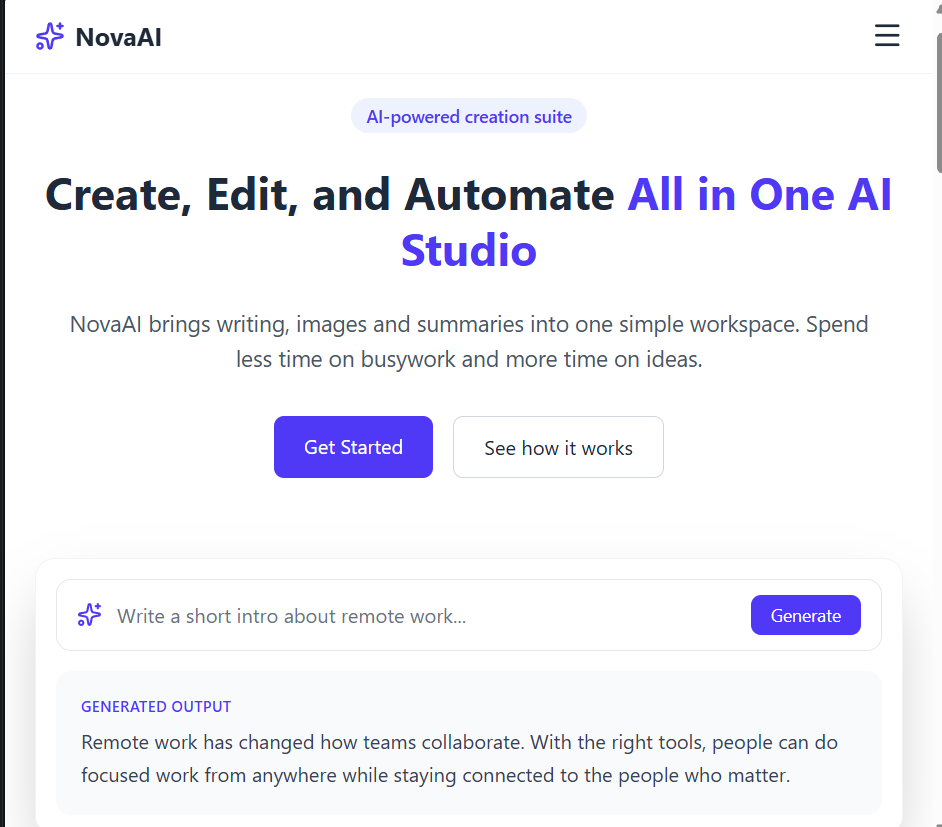

# NovaAI

A responsive landing page for NovaAI, a fictional all-in-one AI studio
(AI Writer, Image Studio, Smart Summarizer). Front-end only, no backend.

**Live demo:** https://your-link.vercel.app

## Features
- Responsive layout (mobile, tablet, desktop)
- Sticky navbar with smooth scrolling and mobile hamburger menu
- Hero section with mock AI prompt card
- Features, How it works, and Pricing sections
- Monthly / Yearly pricing toggle
- Demo request form with validation and success message

## Tech Stack
- React (Vite)
- Tailwind CSS
- lucide-react (icons)

## Run Locally
1. Clone the repo: `git clone https://github.com/<username>/NovaAI.git`
2. Go into the folder: `cd NovaAI`
3. Install dependencies: `npm install`
4. Start the dev server: `npm run dev`
5. Open the local link shown in the terminal

## Screenshots
![Desktop]

![Mobile]

